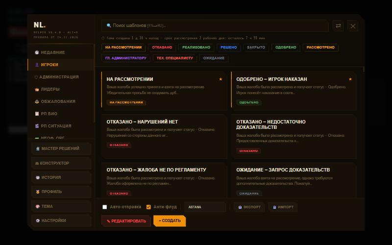
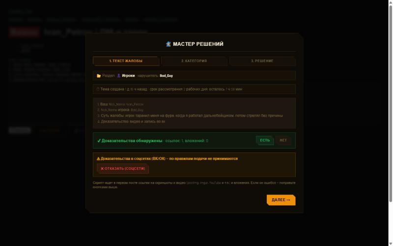
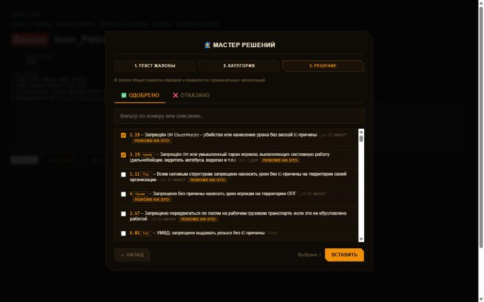
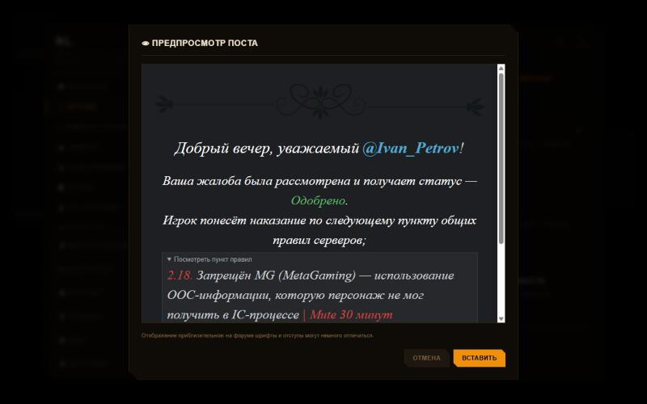
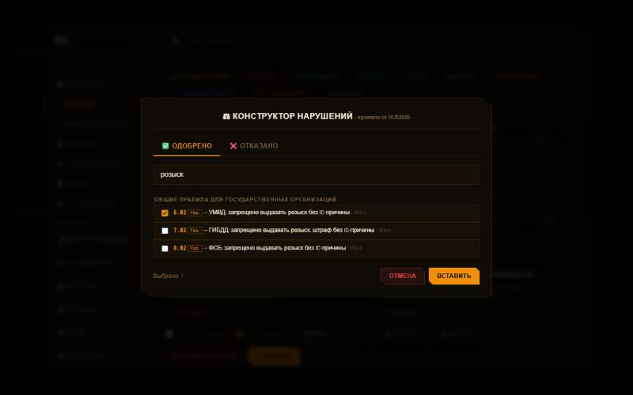
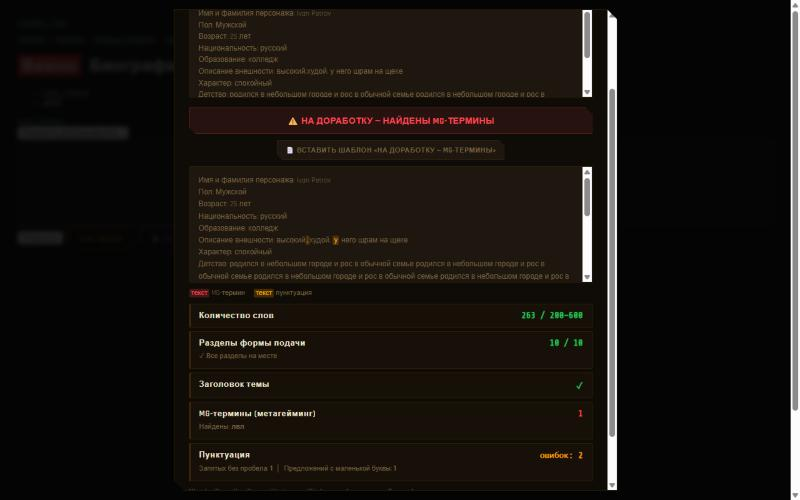

<div align="center">

# ⬡ NL Helper

**Помощник куратора форума Black Russia**

Мастер разбора жалоб, шаблоны ответов, командная строка, анализ РП-биографий и статистика с профилем — прямо в теме на форуме, без лишних вкладок и копипаста.

[](https://greasyfork.org/en/scripts/582289-nl-helper)
[](https://www.tampermonkey.net/)
[](./CHANGELOG.md)
[](https://forum.blackrussia.online/categories/%D0%9F%D1%80%D0%B0%D0%B2%D0%B8%D0%BB%D0%B0-%D1%81%D0%B5%D1%80%D0%B2%D0%B5%D1%80%D0%BE%D0%B2.50/)
[](https://github.com/nuratropic/nl-helper/actions/workflows/ci.yml)
[](./LICENSE)

<p>
<a href="#возможности">Возможности</a> ·
<a href="#установка">Установка</a> ·
<a href="#использование">Использование</a> ·
<a href="#настройки">Настройки</a> ·
<a href="./docs/FAQ.md">FAQ</a> ·
<a href="#разработка">Разработка</a>
</p>



</div>

---

<a id="описание"></a>
## 📋 Описание

**NL Helper** — Tampermonkey-скрипт для кураторов и модераторов форума **Black Russia**. Он добавляет на страницу темы мастер пошагового разбора жалоб, панель с готовыми шаблонами ответов (в виде окна или док-панели сбоку), командную строку для быстрых действий, инструмент проверки РП-биографий и статистику с профилем куратора — без переключения между вкладками и ручного копирования текста.

Весь анализ выполняется локально в браузере. Шаблоны сверены с разделом форума [«Правила серверов»](https://forum.blackrussia.online/categories/%D0%9F%D1%80%D0%B0%D0%B2%D0%B8%D0%BB%D0%B0-%D1%81%D0%B5%D1%80%D0%B2%D0%B5%D1%80%D0%BE%D0%B2.50/) (редакция от 14.11.2026), а скрипт сам предупредит, если правила на форуме изменятся.

<a id="возможности"></a>
## 🎯 Возможности

<table>
<tr>
<td width="50%" valign="top">

**🧙 Мастер решений**
Кнопка «Разобрать» читает первый пост темы и сам определяет раздел (жалоба на игрока, администратора, лидера, обжалование) по «хлебным крошкам» форума. Проверяет доказательства (postimg, imgur, YouTube и т.п. — и в тексте, и в ссылках-словах), заполненность формы подачи, название темы, доказательства во ВК/ОК, показывает срок рассмотрения и ник нарушителя. Для жалоб на игроков сортирует по похожести на текст все пункты общих правил и правил гос./криминальных организаций, для жалоб на лидеров — «Правила и обязанности лидера». Пост собирается в один клик.

**⌨ Командная строка**
`Alt`+`K` — живые подсказки: «2.01 одобрено», «2.19п», «гос 1.07», «крим 4 +», «лид 3.21 -» сразу вставляют пост по пункту; произвольный текст ищет по шаблонам; «био», «статистика», «правила», «настройки» открывают нужное окно.

**⭐ Шаблоны**
Около 200 готовых шаблонов: игроки (по каждому из 72 пунктов общих правил и 3 примечаниям — «одобрено» и «отказано»), администрация, лидеры, обжалования, РП-биографии и ситуации, неофициальные организации — плюс раздел под свои заготовки. Поиск по номеру, названию и сленгу («дм», «скам», «перекид»…), без разницы е/ё и раскладки.

**⚖ Конструктор нарушений**
Все правила с чекбоксами, по разделам: общие правила серверов, правила гос. и криминальных организаций, правила лидера. Отмечаешь несколько пунктов — в ответ уходит один пост.

**📋 Анализ биографий**
По «Правилам составления RP биографии»: объём 200–600 слов, разделы формы подачи, заголовок «Биография | Nick_Name», MG-термины и пунктуация — с подсветкой проблем прямо в тексте (в том числе внутри спойлеров) и кнопкой подходящего шаблона.

</td>
<td width="50%" valign="top">

**🔔 Слежение за правилами**
Раз в 12 часов скрипт смотрит даты последних сообщений в темах с правилами и показывает уведомление, если что-то изменилось после редакции, с которой сверены шаблоны.

**👁 Предпросмотр**
Пост можно посмотреть до вставки — в настройках включается режим «сначала предпросмотр», а в редакторе шаблона есть кнопка 👁.

**🖼 Оформление поста**
Картинки шапки и подвала, обращение, строка перед сервером и подпись меняются в настройках без правки кода.

**⏱ Сроки и сервер**
В окне видно, сколько тема ждёт ответа и сколько осталось до конца срока рассмотрения. Название сервера для `{server}` берётся из раздела форума автоматически.

**📌 Панель сбоку**
Вместо окна по центру помощник выезжает панелью справа, и тема форума остаётся видна.

**🏅 Профиль и 📊 статистика**
Уровень, ачивки, серии дней, любимые шаблоны, PNG-карточка профиля; история, разбивка по разделам и дням, экспорт в CSV.

**↺ Отмена вставки**
Предупреждение, если в редакторе уже есть ваш текст, и кнопка «Отменить» (или `Alt`+`A`).

**🎮 Интерфейс**
8 тем оформления (включая две в стиле Detroit: Become Human), горячие клавиши, полная работа с клавиатуры (`Tab`, `Enter`, `Esc`) и подписи для экранных дикторов.

</td>
</tr>
</table>

<details>
<summary>📸 Скриншоты</summary>

| Мастер: проверка жалобы | Мастер: подбор пунктов |
|---|---|
|  |  |
| **Предпросмотр поста** | **Конструктор нарушений** |
|  |  |
| **Анализ биографии** | |
|  | |

</details>

<a id="установка"></a>
## 🚀 Установка

**Понадобится:** браузер (Chrome, Firefox, Edge и т.п.) и расширение [Tampermonkey](https://www.tampermonkey.net/).

1. Установите Tampermonkey — [Chrome / Edge](https://chrome.google.com/webstore/detail/tampermonkey/dhdgffkkebhmkfjojejmpbldmpobiwkp) · [Firefox](https://addons.mozilla.org/firefox/addon/tampermonkey/)
2. Откройте страницу скрипта на [Greasy Fork](https://greasyfork.org/en/scripts/582289-nl-helper) и нажмите **Install this script**, затем подтвердите установку в Tampermonkey.
3. Перейдите на `forum.blackrussia.online` и откройте любую тему — рядом с кнопкой ответа появится **⬡ NL HELPER**.

Обновления Tampermonkey подтягивает сам (в скрипте указан адрес обновлений Greasy Fork). Если кнопка не появилась или что-то работает не так — загляните в [FAQ](./docs/FAQ.md).

<a id="использование"></a>
## 📖 Использование

### Горячие клавиши

| Клавиши | Действие |
|---|---|
| `Alt` + `H` | Открыть / закрыть главное окно |
| `Alt` + `K` | Командная строка с живыми подсказками |
| `Alt` + `B` | Анализатор биографий |
| `Alt` + `A` | Отменить последнюю вставку шаблона |
| `Alt` + `1`…`9` | Переключиться между вкладками |
| `↑` / `↓` в поиске | Перейти к предыдущей/следующей карточке или подсказке |
| `Enter` | Вставить выделенную карточку / выполнить подсказку |
| `Tab` / `Shift`+`Tab` | Перемещение по элементам окна (фокус не уходит за окно) |
| `Esc` | Закрыть текущее окно (работает и при выключенных хоткеях) |

Хоткеи работают в любой раскладке и не конфликтуют с AltGr. Отключаются в настройках.

### Вкладки

| # | Вкладка | Назначение |
|---|---|---|
| 1 | 🕐 Недавние | Последние использованные шаблоны |
| 2 | 👤 Игроки | Жалобы на игроков, по пункту правил и общие ответы |
| 3 | 🛡 Администрация | Жалобы на администраторов |
| 4 | 👑 Лидеры | Жалобы на лидеров фракций |
| 5 | ⚖️ Обжалования | Обжалования наказаний |
| 6 | 📋 РП Био | Ответы по биографиям |
| 7 | 🎬 РП Ситуация | Ответы по РП-ситуациям |
| 8 | 🔫 НеОф. Орг. | Заявки на неофициальные организации |
| 9 | ⭐ Мои | Личные шаблоны |

При первом открытии окна в теме вкладка выбирается по разделу форума (например, в «Жалобах на лидеров» — «Лидеры»).

### Плейсхолдеры

| Плейсхолдер | Подставляется |
|---|---|
| `{nickname}` | Ник автора темы |
| `{mention}` | Упоминание вида `[USER=id]ник[/USER]` |
| `{violator}` | Ник нарушителя из формы жалобы («Nick_Name игрока/администратора/лидера») |
| `{curator}` | Ваш ник (кто отвечает) |
| `{server}` | Название сервера — из раздела форума или из настроек |
| `{date}` / `{time}` | Текущие дата и время |
| `{greeting}` | Приветствие по времени суток |
| `{thread_id}` | Номер текущей темы |

Плейсхолдеры работают в своих шаблонах и в текстовых полях оформления поста (например, подпись «Куратор {curator}»).

<a id="темы-оформления"></a>
### 🎨 Темы оформления

| Тема | Цвет | Настроение |
|---|---|---|
| 🟠 **Amber** | `#f0900a` | Основная — горячая, энергичная |
| 🟣 **Purple** | `#a855f7` | Мистическая, элегантная |
| 🔵 **Cyan** | `#06b6d4` | Холодная, технологичная |
| 🔴 **Crimson** | `#ef4444` | Интенсивная, агрессивная |
| 🟢 **Matrix** | `#22c55e` | Киберпанк, хакерская |
| ⚪ **Arctic** | `#e2e8f0` | Минималистичная, чистая |
| 🤖 **CyberLife** | `#00a9cc` | Detroit: Become Human — светлый интерфейс андроида |
| 🌃 **Deviant** | `#35d6ea` | Detroit: Become Human — тёмная «девиантная» ночь |

> [!NOTE]
> Темы **CyberLife** и **Deviant** меняют не только цвета: шрифты Michroma/Jost, пульсирующий LED-индикатор, сканирующая линия, рамки-скобки на карточках — и пасхалки. Попробуйте набрать `rA9`, `connor` или `иерихон` в командной строке (`Alt`+`K`).

<a id="настройки"></a>
## ⚙️ Настройки

Окно настроек (⚙️ в главном окне) позволяет:

- включать/отключать горячие клавиши и выбирать режим «Окно» или «Панель сбоку»;
- брать сервер и вкладку из раздела форума автоматически (или выключить это);
- включить предпросмотр перед каждой вставкой;
- следить за обновлениями правил на форуме и проверить их вручную;
- настроить оформление поста: картинки шапки и подвала, обращение, строку перед сервером, подпись (с предпросмотром и сбросом по умолчанию);
- задать объём биографии (по умолчанию 200–600 слов) и список MG-терминов;
- сделать резервную копию шаблонов в JSON и восстановить её (понимает и файлы старых версий);
- сбросить стандартные шаблоны — вкладка «Мои» при этом сохраняется.

Изменения применяются только по кнопке «Сохранить»; «Отмена» и `Esc` их отбрасывают.

<a id="конфиденциальность"></a>
## 🔒 Данные и конфиденциальность

Шаблоны, настройки, статистика и история хранятся локально через `GM_setValue`/`GM_getValue` и никуда не отправляются. Скрипт обращается только к самому форуму (смена префикса темы и проверка дат в темах с правилами) и к Google Fonts за шрифтами — их он загружает только при первом открытии окна. Подробнее — в [SECURITY.md](./SECURITY.md).

<a id="разработка"></a>
## 🛠 Разработка

```
nl-helper/
├── nl_helper.js          # готовый скрипт для Tampermonkey (собирается из src/)
├── src/                  # исходники по модулям, склеиваются по порядку имён
│   ├── 00-meta.js        # заголовок userscript
│   ├── 04-rules-general.js   # таблица «Общих правил серверов»
│   ├── 05-rules-orgs.js      # правила гос./крим. организаций и лидеров
│   └── …                 # хранилище, окна, мастер, стили, инициализация
├── tools/build.js        # сборка и проверка (без зависимостей)
├── tests/                # тесты логики, фикстуры, локальный стенд
├── docs/                 # FAQ, как обновить правила, скриншоты
├── CHANGELOG.md · CONTRIBUTING.md · SECURITY.md · LICENSE
└── .github/workflows/ci.yml
```

```bash
npm run build   # собрать nl_helper.js из src/
npm run check   # убедиться, что nl_helper.js совпадает со сборкой
npm test        # тесты: правила, хранилище, миграция, подбор пунктов, биографии
npm run stand   # локальная имитация темы форума: http://127.0.0.1:8765/threads/test.12345/
```

Нужен только Node.js 18+. Как обновить таблицу правил после изменений на форуме — в [docs/UPDATING-RULES.md](./docs/UPDATING-RULES.md); общий порядок работы — в [CONTRIBUTING.md](./CONTRIBUTING.md).

**Стек:** чистый JavaScript (ES2020), Tampermonkey `GM_*` API, CSS Grid/Flexbox; шрифты Rajdhani и Share Tech Mono (в темах Detroit — Michroma и Jost).

<a id="нашли-баг"></a>
## 🐛 Нашли баг?

1. Посмотрите [FAQ](./docs/FAQ.md) и [Issues](https://github.com/nuratropic/nl-helper/issues) — возможно, ответ уже есть.
2. Если нет — создайте Issue с описанием, шагами воспроизведения и, по возможности, скриншотом.

> [!WARNING]
> Об уязвимостях **не пишите в публичные Issues** — порядок описан в [SECURITY.md](./SECURITY.md).

<a id="версионирование"></a>
## 📊 Версии

Текущая версия — **6.4.0**, история изменений — в [CHANGELOG.md](./CHANGELOG.md). Используется [Semantic Versioning](https://semver.org/): MAJOR — несовместимые изменения, MINOR — новые функции, PATCH — исправления.

<a id="лицензия"></a>
## 📝 Лицензия

MIT License © 2024–2026 [Nicki_Lachowski](https://github.com/nuratropic) — полный текст в [LICENSE](./LICENSE).

## 🙏 Благодарности

Спасибо всем кураторам Black Russia за сотрудничество и обратную связь! ❤️

<a id="контакты"></a>
## 📞 Контакты

| Канал | Ссылка |
|---|---|
| GitHub | [nuratropic/nl-helper](https://github.com/nuratropic/nl-helper) |
| Форум | [Nicki_Lachowski](https://forum.blackrussia.online/members/nicki_lachowski.2210536/) |
| Telegram | [@zhanzun23](https://t.me/zhanzun23) |

---

<div align="center">

**Made with ❤️ by Nicki_Lachowski**

*Last updated: ноябрь 2026*

</div>
